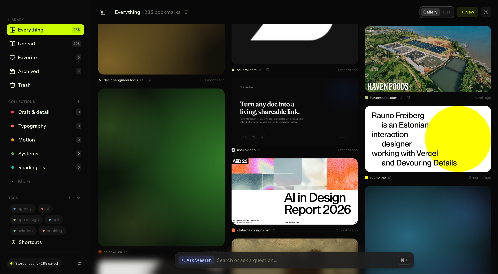

# Gradient placeholders for cards with no preview image

**Date:** 2026-07-30
**Commit:** `efb5fd3` — *Give cards with no preview a gradient placeholder*
**Scope:** app code. **Reframing was not shipped** — the masonry's native-aspect
behaviour for cards with images is untouched.
**Predecessors:** [phase 1](2026-07-30-content-aware-reframing-phase-1.md) ·
[phase 2](2026-07-30-content-aware-reframing-phase-2.md) ·
[grid mock + prototype](2026-07-30-reframed-grid-and-gradient-placeholders.md)

---

## Results

| | |
|---|---|
| placeholders generated | **47** (46 in Everything, 1 archived) |
| favicon-seeded hue | **22** |
| house-palette hue | **25** |
| shapes (Everything view) | 1.6:14 · 1.33:9 · 0.8:11 · 1.91:7 · 1.0:5 — all five used |
| compositions used | **10/10** |
| adjacent pairs | 50 |
| cards nudged for adjacency | **11**, worst case 3 passes |
| residual hue collisions | **0** |
| hues inside the volt guard band | **0 of 47** |
| calibration | **clean** — all three screens byte-identical across launches |

Harness after: `everything` and `settings` clean on styles, clipping and tokens;
`drawer-open` keeps its two known borrowed-spec outline findings. Delta unchanged
at 1.07%.

## Grain — the gate, and a correction

The brief gated everything on grain stability, correctly: an `feTurbulence` layer
is the same family as the `filter: blur(26px)` that once made captures bistable
and cost twenty calibration runs to find.

**Before building anything:** a CSS `feTurbulence` data URI over card images is
**byte-identical across two separate launches**, with and without
`mix-blend-mode`.

**After building:** scrolling placeholders into view and capturing twice
**differs**. My first reading of that was "grain breaks reproducibility with
placeholders on screen" — and that was wrong. Forcing
`content-visibility: visible` makes the same scrolled capture **byte-identical
with grain still on**. The variable is `content-visibility: auto`'s render timing
after a programmatic scroll, which the harness's own screens never perform.

So **no capture-time stabilise rule was added.** Adding one would have made the
harness measure something the app does not render, for a cause it does not have.
The finding is recorded in `STABILISE_CSS` so it is not re-derived.

## What was built

**Schema** (`db.js`, idempotent `PRAGMA table_info` guards): `ph_comp`,
`ph_hue_a`, `ph_hue_b`, `ph_hue_c`, `ph_aspect`. Saturation and lightness are
deliberately **not** stored — they come from the house palette in CSS, so the
library's register can be retuned without a migration. Verified idempotent by
running the real migration and backfill twice over a copy of the real library:
pass 1 generated 47, pass 2 scanned 0.

**Generation** (`main/placeholder.js`): pure functions of the domain string.
Computed at save time for new bookmarks, backfilled for existing ones through the
`images:size-sweep` path that already existed.

**Favicon hue** (`main/faviconHue.js`): main has no image decoder, so this
decodes PNG directly through Node's `zlib` — 34 of 38 cached favicons are PNG.
Validated against the sharp-based prototype analysis: **agrees on 20 of 22, with
zero hue disagreements over 25°**. The 2 misses are ICO and JPEG and fall back to
the domain hash.

**Volt guard**: hues are kept out of a 40° band around the volt accent (72°).
Hash-derived hues use a bijection onto the remaining 320° so the distribution
stays even; favicon-derived hues are pushed to the nearest band edge so a lime
brand keeps its identity. Verified 0 of 47 inside the band.

**Compositions** (`renderer/lib/placeholder.js`): the ten arrangements as CSS
radial-gradients, **not** SVG blobs under a blur — radial gradients are soft by
construction, so no `feGaussianBlur` is involved anywhere. Geometry stays
fractional and diagonal-scaled: CSS resolves a gradient's radii against width and
height separately, so the percentages are derived from the aspect to reproduce
diagonal scaling exactly while staying unitless. Nothing to recompute on resize.

**Determinism**: `LEVEL_EPS = ∞` — no column levelling, so a card's shape cannot
change because something was inserted above it. Costs ~96px of column raggedness,
measured, and chosen for it.

**Adjacency**: unchanged rule — same column above/below, plus neighbouring-column
cards overlapping by more than half the shorter card's height; collisions within
30° nudge the later card 48° and give it a different composition.

**States**: hover and focus lift brightness and saturation on the same durations
and easing as every other card affordance. The prototype had neither.

**Fixture**: its 227 filler cards have no preview, so the backfill sweep — which
fires 1200ms after mount, inside the harness's settle window — would have written
to the fixture mid-capture and made run 1 differ from run 2. They are now seeded,
same class of fix as the earlier `image_w` seeding.

## Corrections made during the work

1. **"Grain breaks reproducibility"** — wrong, see above. It is
   `content-visibility: auto` render timing under a programmatic scroll.
2. **"4 residual adjacency collisions"** — that was my measurement, not the
   algorithm. The in-app audit parsed hue from the painted base colour, which at
   5.5% lightness has too little rgb precision to recover a hue. The exact audit
   from stored hues is clean at 0.

## Anything missed / caveats

- **The harness does not exercise this work.** All 227 fixture placeholders sit
  below the fold, so calibration passing says nothing about placeholder
  rendering. It was verified separately by scrolling them into view across two
  launches. Making the harness cover it would mean a fixture whose visible cards
  include placeholders, which changes the Figma comparison — out of scope here.
- **`content-visibility: auto` is non-deterministic under programmatic scroll.**
  Found incidentally and not chased. It does not affect the harness today
  because no screen scrolls the gallery, but it would bite any future screen
  that does.
- **ICO and JPEG favicons are not decoded** — 4 of 38. They fall back to the
  domain hash, which is a complete answer, not a degraded one.
- **Light theme is unstyled for placeholders.** The compositions assume a dark
  ground; `[data-theme='light']` was not addressed.
- **No reduced-transparency or forced-colors handling.** `prefers-reduced-motion`
  is handled (transition removed); the other accessibility media queries are not.
- **Adjacency runs on every layout pass.** It is O(n²) over placeholders only —
  46 in this library, 227 in the fixture, both fine — but a library with
  thousands of preview-less cards would want an interval-based sweep.
- **The 0.8 shape takes 11 of 46**, the largest share after 1.6. The prototype
  review found 0.8 the weakest shape on real images; for placeholders there is no
  subject to strand, so it was left in. Worth an eye in the running app.
